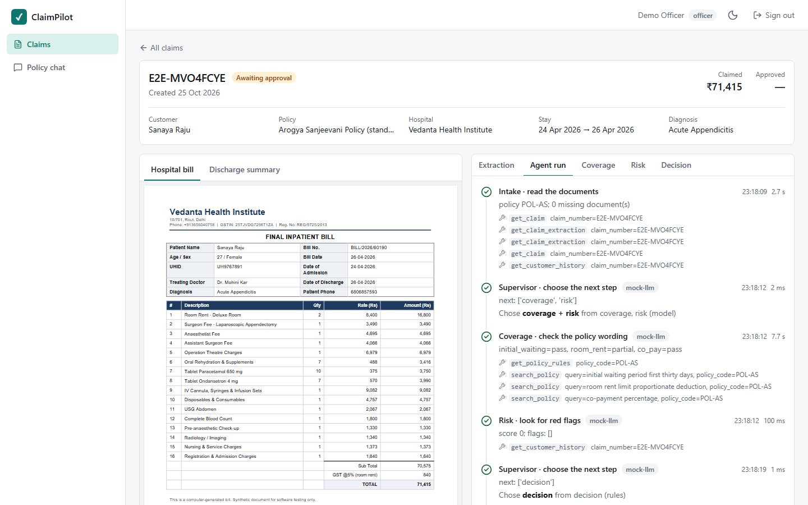
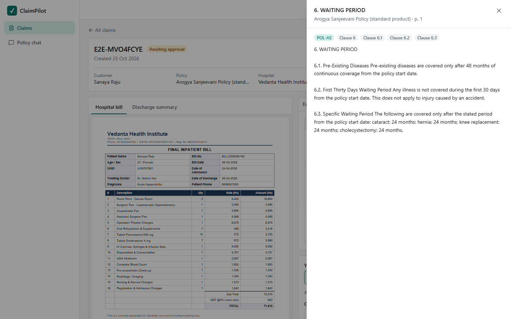
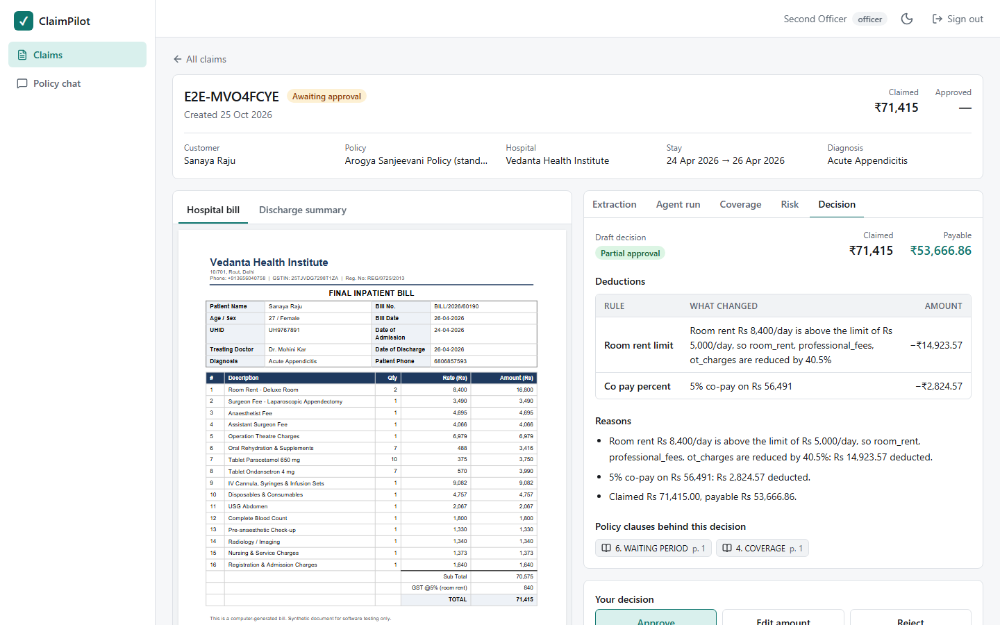
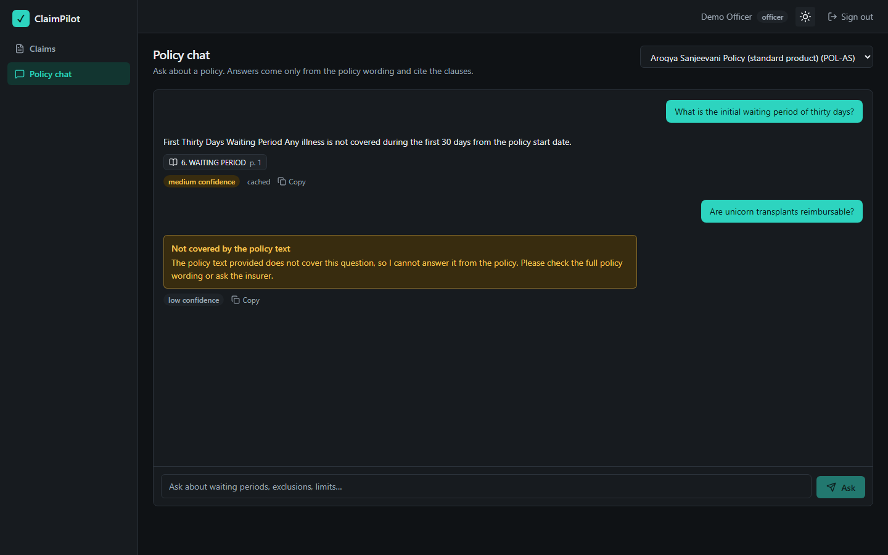

# ClaimPilot

Health-insurance claims copilot: RAG over policy wordings (with clause citations), LangGraph agents
(intake, coverage, risk, decision and a supervisor) with human approval, MCP servers for data access,
and an evaluation harness that measures all of it. Built module by module; [CLAUDE.md](CLAUDE.md) is
the project record and the roadmap. Status: modules 0-11 done (backend, agents, evaluation,
observability and hardening, the React web app); the cloud deployment comes next.

## Run

```bash
cp .env.example .env     # fill in OPENAI_API_KEY (GROQ_API_KEY for the fallback), JWT_SECRET and the SEED_* passwords
make up                  # postgres, redis, backend, worker, and the three MCP servers
make migrate && make seed
curl localhost:8000/health/ready     # the port is BACKEND_HOST_PORT (default 8000)
# the web app: http://localhost:3000 (FRONTEND_HOST_PORT)
```

### Try it without API keys

`MOCK_LLM=true` swaps the chat model and the embeddings for deterministic fakes, so the whole app runs with no
keys and no cost (it reads the real documents and the policy text; it is not a model). `make e2e-up` starts an
isolated stack with it (own database, http://localhost:3300) and loads synthetic policy wordings and demo users:

| User | Role |
|---|---|
| `demo-officer@example.test`, `demo-officer2@example.test` | officer |
| `demo-admin@example.test` | admin |

Password `demo-pass-12345` (`DEMO_PASSWORD` to change). Upload the two PDFs of any folder in `data/claims/`, press
*Run full processing*, watch the agents, open a citation, and approve as the second officer. `make e2e` runs the
browser tests against it; `make e2e-down` removes it. Mock mode is refused when `APP_ENV=production`.

### Screenshots

| | |
|---|---|
|  |  |
|  |  |

More in [docs/screenshots/](docs/screenshots/).

Every endpoint but `/health`, `/health/ready`, `/auth/login` and `/auth/refresh` needs a token:

```bash
TOKEN=$(curl -s localhost:8000/auth/login -H 'content-type: application/json' \
  -d '{"email":"officer@example.com","password":"<SEED_OFFICER_PASSWORD>"}' | jq -r .access_token)
curl -s localhost:8000/policies -H "Authorization: Bearer $TOKEN"
```

Access tokens last 15 minutes; `POST /auth/refresh` rotates the 7-day refresh token.
Roles: **officer** (claims, upload, start runs, approve / edit / reject, policy questions) and
**admin** (everything, plus policy ingestion, `/admin/audit-logs`, `/admin/usage`, `/admin/users`).
The reviewer of an approval is the authenticated user, and an officer cannot approve a claim they
uploaded (an admin can, with a written reason that goes to the audit log).

## Develop

| Command | What |
|---|---|
| `make test` | pytest (no real LLM or network calls) |
| `make lint` / `make fmt` | ruff check / format |
| `make audit` | pip-audit over the installed dependencies |
| `make revision m="msg"` | new Alembic autogenerate revision |
| `make eval-rag` / `make eval-e2e` | RAG evaluation / end-to-end agent evaluation (spend API credits) |
| `make e2e-up` / `make e2e` / `make e2e-down` | isolated MOCK_LLM stack + Playwright browser tests (no API cost) |
| `cd frontend && npm test` / `npm run lint` | Vitest + ESLint + `tsc` for the web app, see [frontend/README.md](frontend/README.md) |
| `make langfuse-up` | optional self-hosted Langfuse on http://localhost:3001 |
| `make shell` / `make logs` | bash in the backend container / follow its logs |

CI (`.github/workflows/ci.yml`) runs ruff, pytest against Postgres + pgvector and Redis, and pip-audit
on every push and pull request. `eval.yml` is a manual workflow that runs the two evaluations with
the repository secrets and uploads `report.md`.

## Configuration

Everything comes from environment variables (`.env`, see `.env.example` for every one with its
default). The ones you will touch:

| Variable | What |
|---|---|
| `APP_ENV` | `development`, `test` or `production`. In production the app refuses to start with development defaults (JWT secret, database credentials, localhost CORS, well-known seed passwords). |
| `DATABASE_URL`, `REDIS_URL` | Postgres (with pgvector) and Redis. |
| `OPENAI_API_KEY`, `GROQ_API_KEY` | Primary LLM and embeddings; the Groq key enables the fallback. |
| `ANTHROPIC_API_KEY` | Used by the evaluation runs (`make eval-*`), not by the app. |
| `JWT_SECRET`, `ACCESS_TOKEN_MINUTES`, `REFRESH_TOKEN_DAYS` | Token signing and lifetimes. |
| `LOGIN_MAX_FAILURES`, `LOGIN_WINDOW_MINUTES` | Login lockout per e-mail and IP. |
| `RATE_LIMIT_*` | Requests per minute per user and per IP; stricter for the LLM endpoints. |
| `DAILY_LLM_BUDGET_INR`, `USD_INR_RATE` | Estimated daily spend limit (0 = off) and the rate used to convert. |
| `USE_WORKER`, `WORKER_*` | Run agent runs, extraction and ingestion in the arq worker (default in compose). |
| `LANGFUSE_PUBLIC_KEY`, `LANGFUSE_SECRET_KEY`, `LANGFUSE_HOST` (or `LANGFUSE_BASE_URL`) | Optional tracing. Without the keys nothing is traced and nothing is sent. |
| `CORS_ORIGINS` | Comma-separated allowed origins (the web app is same-origin through its `/api` proxy and does not need it). |
| `MOCK_LLM` | `true`: fake model and embeddings, no keys, never allowed in production. |
| `FRONTEND_HOST_PORT` | Host port of the web app (default 3000). |
| `MCP_<SERVER>_TOKENS` | Bearer tokens of the MCP servers (placeholders are refused in production). |

## Observability

- **Traces** (Langfuse, optional): one `claim_run` trace per agent run (session = claim number,
  tags `scenario:live|eval` and `policy:<code>`), a `policy_query` trace per policy question, spans
  for the RAG stages, OCR pages and every MCP tool call. Inputs and outputs are masked (phone, e-mail,
  Aadhaar, PAN, patient names) before they leave the process. Responses carry `X-Request-ID` and
  `X-Trace-ID`; log lines carry `request_id`, `trace_id`, `run_id` and `claim_number`.
- **Metrics**: `GET /metrics` (admin token or `METRICS_TOKEN`): HTTP latency and counts, LLM calls,
  tokens, cost in INR and fallbacks per provider / model / node, the circuit breaker, cache hits,
  agent runs, OCR pages, MCP tool calls. The worker serves its own on port 9102.
- **Evaluation in Langfuse**: `--langfuse` on the two evaluation runners pushes scores, the golden
  datasets and one dataset run per evaluation.
