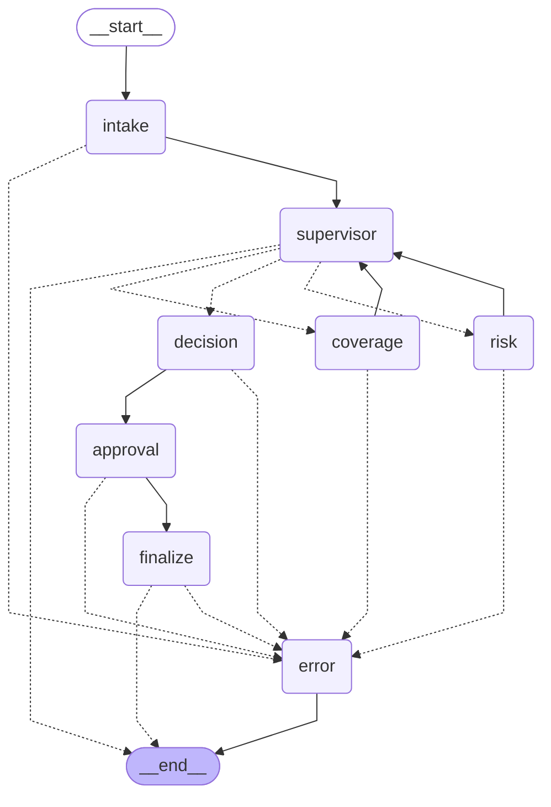

# Agent graph (Module 8)

Generated by `python -m app.agents.export_graph`. Solid arrows are fixed edges; dashed
ones are conditional hops decided at run time (the supervisor's routing and the
hop to `error` when a node fails).

